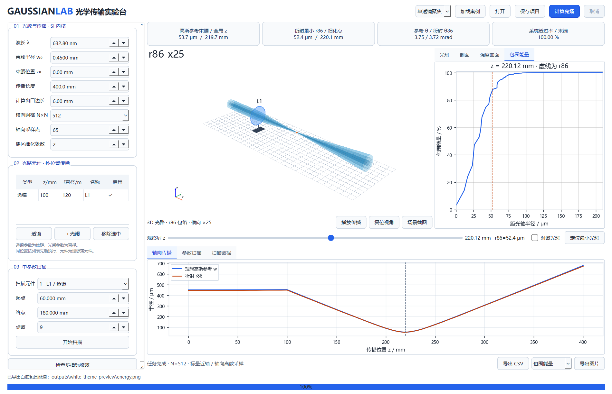

# GaussianLab 当前源码版使用说明

更新日期：2026-11-18。本说明针对 V3.1.0 源码。已发布的 V3.0.0 便携启动见 [V3 指南](USER_GUIDE-v3.0.0.md)，旧版保留 [V2.0.0 指南](USER_GUIDE-v2.0.0.md)。白色界面与图片导出功能源自 `853e9b3`，CUDA/交互功能源自 `a2a7363`。完整原理、架构和逐文件说明见 [项目学习手册](项目学习手册.md) 与 [离线阅读版](项目学习手册.html)。

历史 V0.1.0 操作见 [初版指南](USER_GUIDE-v0.1.0.md)，不把旧版截图或按钮说明当作 V3 界面。

## 1. 启动与版本识别

在项目根目录双击 `启动软件.cmd`，或执行：

```powershell
.\.venv\Scripts\python.exe -m gaussian_lab
```

界面有白色背景、右上四个分析标签，以及右下图像类型选择与“导出图片”按钮。源码窗口显示 V3.1.0，已发布便携包显示 V3.0.0。旧窗口需要关闭后重新启动，源码更新不会自动替换旧版 EXE。

源码启动默认勾选“改参后自动预览”：停止输入 400 ms 后更新，最多 N=256、33 个轴向点、焦区细化为 0。图下明确显示“快速预览”；点击“计算光场”才按输入的网格、轴向点数和焦区细化执行完整计算。也可关闭自动预览继续手动计算。

光源数值框支持键盘输入后停顿更新，无需额外按回车；元件表格按回车或移出单元格提交编辑后自动预览。尚未提交的表格编辑不属于新参数快照。

“计算后端”可选自动、CPU 或 CUDA 优先。自动模式 N<512 使用 CPU；CUDA 优先允许小网格也使用显卡。没有兼容 NVIDIA 设备、运行库或设备自检失败时自动回退 CPU，实际后端显示在结果状态，原因可悬停查看并随数据导出。便携版已含运行组件，首次 CUDA 需联网补充约 3.6 MB 官方头文件并建立缓存；无需执行源码安装脚本。源码可选库安装与限制见 [加速说明](acceleration.md)。失败检测在会话内缓存，恢复网络或调整环境后需重启程序。三维渲染与数值计算是不同流程。



## 2. 计算与观察

1. 顶部选择“单透镜聚焦”“双透镜扩束”或“光阑衍射”，点击“加载案例”。
2. 左侧修改光源与元件参数；透镜数值是焦距，光阑数值是直径，单位为 mm。
3. 修改参数后等待预览，或点击“计算光场”执行完整计算；输入变更但更新尚未完成时，保留的旧图仍属于上次结果。连续输入会合并，过期计算结果不会覆盖新输入。
4. 点击“定位最小光斑”，或拖动观察屏滑块，选择要分析和导出的 z 面。
5. 在右上切换光斑、剖面、强度曲面或包围能量。白色表示色标低端，红色表示高端；图中强度经过峰值归一化。

三维区域支持滚轮缩放、按住左键拖动旋转，点击“复位视角”恢复默认视角。三维横向放大 25 倍；包络为 r86，支架和透镜外形为示意。

### 方案对比与纵向强度

1. 先点击“计算光场”，在底部“A/B 对比”点击“固定当前为 A”。
2. 在透镜行填写“口径”并提交编辑。空值表示不限口径。再次执行完整计算得到 B。
3. 选“共用观察面”时，以当前观察屏为目标寻找双方最近的共同采样面。选“各自最小光斑面”时，比较各自的焦区结果。对照图标出实际 z、透过率、r86，并以单位入射功率共用光斑和剖面强度标尺。
4. 右下选择“A/B 对比”导出已生成的图。方案 A 保存在当前会话，可点击“清除 A”释放引用。
5. 在“纵向强度”页点击生成按钮，查看沿 z 的中心 x 剖面，点击图中位置移动观察屏。结果更新后重新生成。右下可选择“纵向强度”导出。

拖动上下分析区之间的分隔条，可为对照图或纵向强度图留出更多空间。

## 3. 选择并导出图片

先设置观察屏，再在右下选择图像类型，点击“导出图片”，选择保存位置与格式。

快速预览的默认导出名带 `-preview`，分析图带“快速预览 · 未完成精度验证”标题；CSV 的元数据记录 quality=preview、实际采样和原始请求参数。完整结果使用普通文件名。场景截图只记录当前画面，核对数值时应同时保存项目与数据元信息。

| 导出选择 | 内容和数据来源 | 操作提示 |
| --- | --- | --- |
| 当前分析图 | 右上当前选中的分析标签 | 不由底部曲线页自动决定 |
| 光斑图 | 当前观察面的二维归一化强度 | 遵循“对数光斑”开关；对数色标为 dB |
| 剖面强度曲线 | 当前观察面穿过光轴的 x/y 剖面 | 横轴 mm，纵轴为峰值归一化强度 |
| 强度曲面 | 当前观察面的相对强度高度图 | 高度 I/Imax；不是沿 z 的传播轨迹 |
| 包围能量 | 当前观察面以光轴为圆心的累计能量比例 | 横轴 μm，纵轴 %，虚线对应 r86 与 86% |
| 轴向传播 | 已计算的 w(z) 参考与 r86(z) | 标出当前观察屏位置 |
| 参数扫描 | 最近完成的扫描任务曲线 | 先点击“开始扫描”；该图使用扫描快照 |

可以直接指定未访问过的分析标签，无需先切换过去。单平面图标题标出观察面 z；导出读取已完成的结果快照，尚未重算的输入不会替换图的数据。

支持 PNG、SVG、PDF。PNG 保存为 300 dpi，所有格式均使用不透明白底，并为标题及坐标保留留白。300 dpi 是图像输出设置，不等于计算网格精度；光斑与强度曲面的空间细节仍取决于实际采样。SVG/PDF 中的光斑可能包含嵌入的栅格图像。

取消保存不会生成图片。没有计算结果或扫描结果时，会提示先完成相应任务。“场景截图”单独保存当前三维场景的白底 PNG。

## 4. 参数扫描与收敛

左侧“03 单参数扫描”指定元件、起点、终点和点数，再点击“开始扫描”。底部“参数扫描”和“扫描数据”分别展示曲线和结果表。只点击“计算光场”不会产生扫描数据。

“检查多指标收敛”分别比较横向网格、等间距扩大窗口及轴向细化，记录末端/焦区 r86、焦点位置、θ86、透过率和剖面。基准网格最多 512、焦区细化级数最多 3，且所有变体均需满足结果体积限制。检查结果写入 `outputs/convergence.json`；主场景保留上次光场结果。

数值变化小或警告为空不等于精度认证。更多依据见 [数值增强验证](validation-v2.md)。

## 5. 保存配置与数值数据

“保存项目”保存 JSON，“打开”恢复参数；显示相机和观察屏状态尚未完整保存在项目配置中。

“导出 CSV”根据底部所在页导出轴向或扫描数据：

- 轴向传播页：保存主 CSV、同名 `.project.json` 参数、`.csv.meta.json` 完整指标和匹配收敛记录，以及 `.energy.csv` 焦面包围能量曲线。该能量 CSV 对应数值焦面，和可移动观察屏的图片导出需区分。
- 参数扫描/扫描数据页：保存扫描 CSV、参数配置和 `.csv.meta.json` 扫描设置。状态与说明字段保留警告、失败点及原因。

图片、CSV 与项目 JSON 用途不同，建议同时保留图和对应参数快照；检查保存路径与命名，避免把旧参数图当作新计算结论。

## 6. 常见问题

| 现象 | 处理方式 |
| --- | --- |
| 仍显示深色界面或没有“导出图片” | 核对窗口标题和 EXE 属性为 V3.0.0，并关闭旧窗口；使用 V3.0.0 完整解压目录或当前源码启动器 |
| 自动模式预览显示 CPU | N<512 时自动模式优先 CPU；若需测试显卡，可选“CUDA 优先”，并核对结果的实际后端 |
| 首次 CUDA 等待较久或回退 CPU | 首次需建立缓存并联网补充头文件；查看状态悬停原因，恢复网络或修正环境后重启，不必反复安装完整 Toolkit |
| 图片类型与预期不同 | 明确选择右下类型；“当前分析图”对应右上标签，导出下方曲线请指定“轴向传播”或“参数扫描” |
| 图片与新输入不一致 | 等待自动预览完成，或点击“计算光场”生成完整结果；输入尚未提交或任务未完成时，保留图仍属于上次快照 |
| 光斑看起来有像素或能量曲线出现台阶 | 复核网格与窗口；高输出 dpi 无法补回未计算的细节 |
| 扫描页为空或不能导出扫描图 | 先执行左侧“开始扫描”，等待完成 |
| 保存失败 | 检查目录权限、文件是否被占用及保存路径 |

当前模型限于单色、同轴、近轴标量场、理想薄透镜与圆孔；没有标准 M²、复杂像差、高 NA 矢量或实体实验精度保证。Windows COM 0x8001010d 为已有环境诊断，排查时同时保留进程退出码与实际错误信息。
