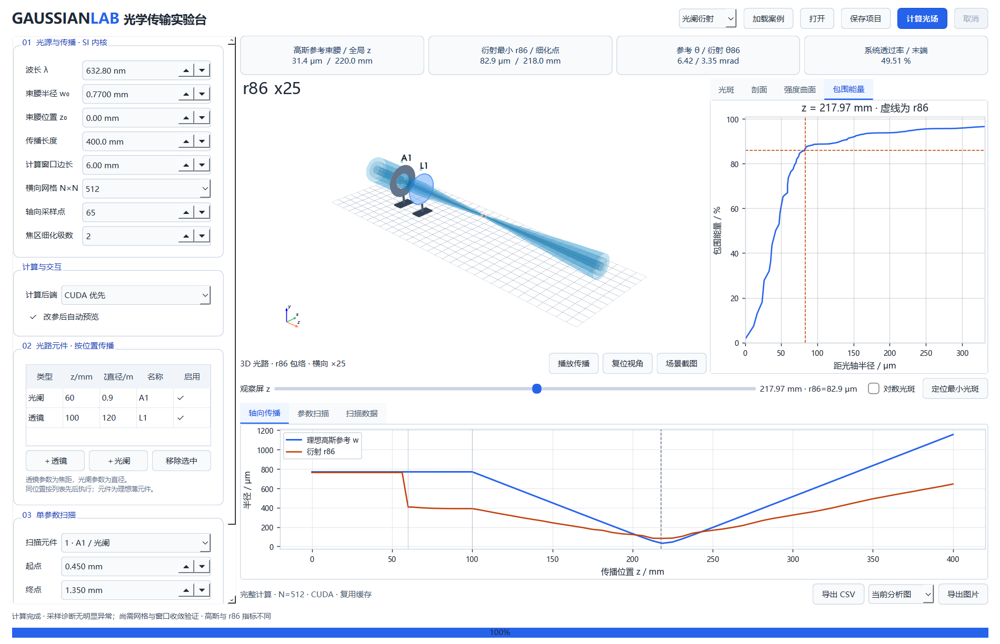

# V3.0.0 CUDA 与交互优化说明

V3.0.0 已正式发布，继承 a2a7363 的 CUDA/响应式预览实现。便携版已含运行组件，首次 CUDA 需联网补充约 3.6 MB 固定官方头文件并建立缓存；日常操作见 [V3 指南](USER_GUIDE-v3.0.0.md)。本页将当前实现与开发阶段性能记录分别说明。

更新日期：2026-11-15。开发基线为 V2.0.0（afaef29），功能来源为 feature/cuda-responsive-preview；正式应用标签为 v3.0.0（b4806c3）。[远端发行与双后端回下载证据](release-validation-v3.0.0.md)已归档，V2.0.0 原始附件保留。

V3.1.1 当前便携包包含 CuPy 与 CUDA FFT 组件，用户无需自行 pip 安装。源码用户双击根目录 `安装显卡加速.cmd`，安装器会执行实际设备/FFT 自检；安装后重启应用。依赖清单缩减为当前传播与 FFT 所需的 6 个固定包，保留完整官方头文件的私有安装。自定义运行库需设置 `GAUSSIANLAB_CUDA_PATH`。本轮包含 HG/LG/相干叠加真实 GPU 验证，见 [交付验证](release-validation-v3.1.1.md)。

网络受限时可通过 `GAUSSIANLAB_CUDA_HEADERS_WHEEL` 指定用户从官方获取的固定轮子，软件照常校验字节数与 SHA-256；无需 Python，初始化后使用本机缓存。步骤见 [V3.1.1 离线初始化](USER_GUIDE-v3.1.1.md)。


## 已实现

- 可选 CuPy CUDA 后端：复光场、FFT、传递函数、能量统计与焦区细化在设备上执行，结果图像传回内存供 Qt/VTK 使用。CPU/GPU 均采用 complex128/float64，结果图像沿用 float32。
- 自动预览：数值框支持键盘输入后停顿 400 ms 更新，无需回车；元件表格在提交单元格编辑后更新。上限 N=256、33 个轴向点、0 级焦区细化，原始物理输入不改写。完整计算按原设置执行，扫描与收敛仍手动触发。
- 调度：一次只执行一个任务；连续改参合并请求，取消过期光场任务并丢弃迟到结果。自动输入校验失败在状态栏等待，不连续弹窗。取消按钮清除待执行任务；关闭窗口先停止定时器再取消工作线程。
- 复用：光路区段频谱与焦区传播复用；会话结果缓存预算 128 MiB，按完整输入、后端及预览/完整类型隔离。仓库状态首次捕获，注明捕获时间，计算时间逐次记录。
- 显示：拖动观察屏合并更新、轴向曲线保留坐标轴只移动游标、同一观察面不重建网格、同一光路外形及采样面数量下直接更新包络点和焦点标记，复用支架/元件/标签。场景批量更新后渲染一次，保留同传播长度下的相机视角。
- 导出：预览图显式带预览标题和默认文件名；CSV 元信息保留 quality、原请求、实际采样与后端。独立导出画布固定快照，避免选路径期间自动更新混入另一份结果。

## 源码启动与可选显卡库

本节仅适用于源码环境。便携版用户完整解压运行包即可，不需要执行下面的安装命令；其首次缓存和联网行为见 V3 指南。

先按 README 创建基础 .venv。直接运行 `启动软件.cmd` 或 `.\.venv\Scripts\python.exe -m gaussian_lab`；不安装显卡库也能运行 CPU。

需要 NVIDIA CUDA 时，在项目根目录运行：

```powershell
$env:PYTHONUTF8 = '1'
.\scripts\install_cuda_runtime.ps1
```

脚本把固定的 CUDA 12.9 组件与 CuPy 14.2.0 独立装入 LOCALAPPDATA/GaussianLab/cuda-v2-dev，不替换 .venv，不修改驱动；可选库体积较大。为避开中文路径下的 NVRTC 头文件兼容问题，安装路径要求 ASCII；中文用户名可用 `-RuntimeDirectory C:\GaussianLabCuda` 指定有写权限的英文目录。自定义目录启动前设置 `$env:GAUSSIANLAB_CUDA_PATH='该目录'`。安装后重启应用。

后端下拉框提供自动、CPU、CUDA 优先。自动模式 N<512 使用 CPU；CUDA 优先可在小网格测试显卡。CPU 选择不导入 CuPy。CUDA 首次进行设备/FFT 自检；缺库、无设备、初始化失败回退 CPU，失败检测在会话中缓存。设备执行故障回退 CPU 并保留原因，取消与物理输入错误不会被当作设备故障吞掉。修复设备环境后重启应用重新检测。

首次 CUDA 初始化、内核编译及磁盘缓存仍可能明显慢于后续计算；不会承诺首次启动也即时完成。GAUSSIANLAB_DISABLE_CUDA=1 可用于禁用显卡路径。结果状态的实际 CPU/CUDA 标签及悬停原因、导出 provenance.backend 比是否看到三维画面更可靠。

## 开发阶段实际性能与一致性

环境：本机 Windows、RTX 4060 Laptop 8 GiB、驱动 617.14、Python 3.10.11、NumPy 2.2.6、CuPy 14.2.0。`scripts/validate_acceleration.py` 从本地 v2.0.0 标签读取旧内核，在同一进程分别预热后各重复三次；下表为中位数秒，含结果回传，不含界面绘制。原始逐次记录、配置和源码摘要见 [性能记录](acceleration-validation.json)。

| 案例 | 网格/轴向点 | V2.0.0 CPU | 优化 CPU | CUDA | 自动预览内核 |
| --- | --- | ---: | ---: | ---: | ---: |
| 单透镜聚焦 | 512 / 65 | 2.291 | 1.161 | 0.151 | 0.113 |
| 双透镜扩束 | 512 / 65 | 2.549 | 1.177 | 0.157 | 0.115 |
| 光阑衍射 | 512 / 65 | 2.453 | 1.196 | 0.152 | 0.106 |
| 光阑衍射 | 1024 / 33 | 7.706 | 3.330 | 0.283 | 0.123 |

这四个固定场景的 CPU 约快 2.0—2.3 倍，CUDA 相对 V2.0.0 约快 15—27 倍；不外推到全部电脑或场景。优化 CPU 与原版、CUDA 与 CPU 的强度最大绝对差均不超过 1.46e-11，r86 差为 0；透过率、远场角与传播面也通过容差检查。未降低完整计算网格或焦区细化来取得这些结果。

真实窗口验证另见 [交互记录](interaction-validation.json) 与 scripts/validate_interaction.py，包含连续改参、CUDA 预览、完整计算、缓存、Qt 心跳及截图；端到端耗时还包括防抖和绘制，不能把纯内核计时解释为每次操作的总响应时间。

最终真实窗口退出码为 0：首次 CUDA 预览约 2.380 s，后续改参预览约 0.659 s（含 400 ms 防抖），完整计算至显示约 0.995 s，同参数缓存约 0.014 s。整轮最大 Qt 心跳间隔约 0.870 s，首次构图仍有明显主线程工作；本轮不等同于所有操作均无卡顿。前期一次不同缓存环境中的首次预览约 9.77 s，故不把最终首次时间当作全新安装冷启动上界。



## 限制与后续

V3 发行包已通过从私有 GitHub 实际下载后的 CPU 与 CUDA 冻结检查，包含自动预览、三个案例、三维渲染和六类图像导出。源码性能表对应开发阶段固定输入与预热条件，不能直接代表发行版首次启动耗时。其他实体电脑、不同显卡/驱动组合和中文用户临时目录仍需实测；不可把本机禁用 CUDA 的检查写成已在另一台无显卡电脑验证。V2.0.0 原包保持 CPU 手动计算口径，不包含 V3 新功能。

预览用于观察趋势，硬孔径、小光斑、远场边界和多峰情况必须用完整计算与收敛检查判断。仍使用有限窗口近轴标量模型；不新增 M²、高 NA 或物理误差认证。GPU 传输、首轮编译、VTK 构图和 Matplotlib 绘制仍有耗时；不同电脑需记录型号、参数及实际后端后比较。
