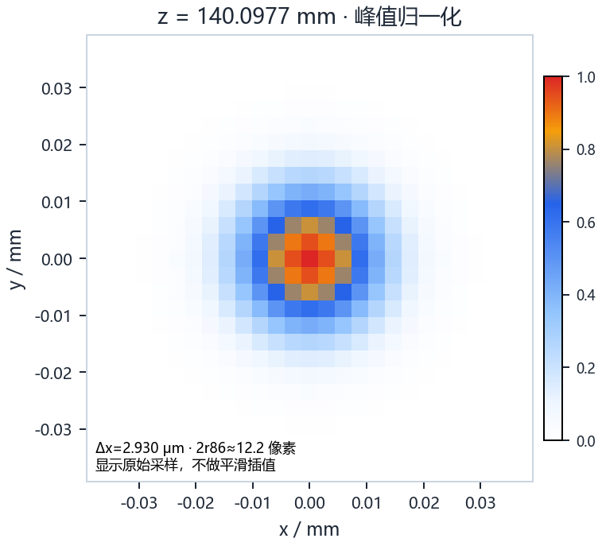
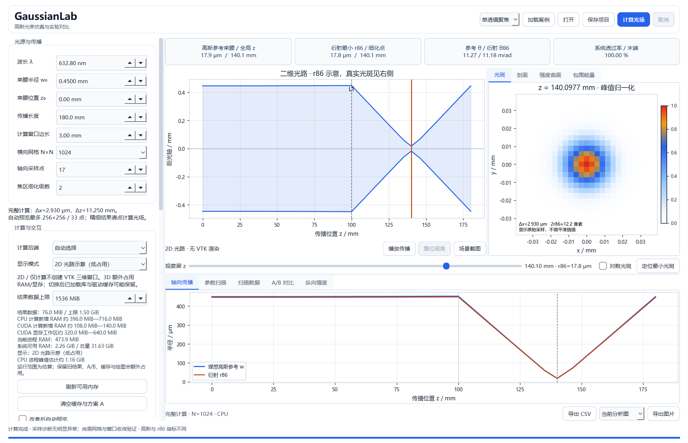

# 内存规划、低占用显示与焦面读图验证

日期：2026-11-23。适用入口为当前源码根目录的 `启动软件.cmd`；已归档便携附件保留其构建时快照。

本文保留上一轮内存上限与最近邻显示的历史验证。后续源码已提供自动磁盘缓存和可选平滑/原始像素，旧 32 MiB 拒绝案例现仅对应 RAM-only 模式；当前行为与新增实测见 [LG/TEM 与存储验证](modes-storage-validation.md)。

## 内存设置与预测

结果数据上限可设置 32—65536 MiB，默认兼容旧项目的 384 MiB，并随项目 JSON 保存。估算面板在超过上限时仍可显示数据量，允许提高上限后重新验证，而不是要求固定降低采样。

观察面由均匀面与启用元件面去重，另预留一个焦面。float32 体积为 `(观察面数+1)×N²×4` 字节，求解器和界面共用同一观察面计算。CPU 与 CUDA 主存/显存工作区单独给出经验范围，系统可用物理 RAM 和当前进程工作集来自 Windows API。结果预算不是整个进程的硬内存限额，FFT、驱动、旧结果、绘图和缓存仍有额外开销。

实算验证：N=128、641 个均匀面、无元件、焦区细化 0，32 MiB 预算被拒绝；改为 41 MiB 后计算成功。预测与 `result.intensity.base.nbytes` 均为 **42,074,112 字节（40.125 MiB）**。没有为了检验预算而分配数 GiB 数据。2048/65/1536 MiB 配置另通过参数与 JSON 往返验证。

## 三种显示模式

2D 和仅计算模式在独立新进程中均未载入 `vtkmodules`。3D 仅在用户选择后创建 Qt/VTK 上下文；退出 3D 时移除并关闭场景。仅计算停止图形更新，仍保留当前计算强度体积用于导出，不能将其理解为零结果内存。

| 本机独立进程空窗口 | 进程工作集 | VTK 是否载入 |
| --- | ---: | --- |
| 仅计算 | 222.7 MiB | 否 |
| 2D 示意 | 217.1 MiB | 否 |
| 3D | 448.2 MiB | 是 |

测量是本机一次冷启动快照，没有运行传播或证明普遍节省比例。库、驱动、Python 内存池可能驻留，切换后不保证立即降到冷启动值。提供“清空缓存与方案 A”，保留当前结果；正在计算时不清理缓存。真实分配失败会提示降低采样、切换低占用显示或清空缓存，并保留上次完成结果。

## 焦面二维光斑

用户确认问题位于右侧二维光斑。旧 `imshow` 以 x[0] 为边缘，实际将像素中心放到 x[0]+dx/2；另外 bilinear 插值和固定最小 ±0.15 mm 视野会掩盖焦区采样。现以 x[0]−dx/2 和 x[-1]+dx/2 为边缘，采用 nearest 显示原始采样，并按 r86 和像素间距自适应视野。图内标明 Δx、2r86 的像素数以及欠采样提示。快速预览定位焦面时先触发完整采样。

固定案例为 λ=632.8 nm、入口 w₀=0.45 mm、窗口 3 mm、传播 180 mm、z=100 mm 处 f=40 mm 理想薄透镜，17 个轴向点、2 级细化、CPU。选中焦面约 z=140.097656 mm。

| 网格 | Δx | 数值 r86 | 中心剖面对解析峰值归一化强度的最大绝对差 | 对 LightPipes 三倍参考束宽区域的强度 RMS 差 |
| --- | ---: | ---: | ---: | ---: |
| 512 | 5.859375 μm | 18.528971 μm | 5.528×10⁻⁶ | 0.019562 |
| 1024 | 2.929688 μm | 17.820593 μm | 5.837×10⁻⁶ | 0.017169 |

LightPipes 使用不同的卷积离散/有限窗口处理，不是真值；区域内最大逐像素差分别约 0.07035、0.07977，不能将 RMS 差解释为每点误差上界。解析结果、数值光场和显示像素分别核验，没有把数值强度强制改成高斯。r86 的像素分位误差与强度误差不同，继续依靠网格/窗口收敛检查。

## 悬停与界面链路

Matplotlib 鼠标事件按 12 个屏幕像素距离查找最近实际采样点，支持轴向、x/y 剖面、能量、扫描双纵轴、A/B 两组子图和 2D 示意。提示包含曲线名称和坐标/单位；参考虚线不被误读为数据曲线，NaN 失败点跳过。Qt 工具提示不加入图内注释，因此不会被写入导出文件。二维光斑可读取像素坐标和显示强度。

完整回归 **140 项通过，0 跳过**（316.20 s），包含真实 CUDA、焦面解析/LightPipes 对照、三种显示切换、独立无 VTK 启动、项目保存和曲线鼠标事件。随后新增的实际内存不足中文提示专项 **1 项通过**（2.91 s）。静态检查确认历史验证脚本显式选择 3D，并固定历史 512 网格基准；未重新运行以免覆盖旧证据。

原始本机记录位于忽略目录 `outputs`：`display-memory-measurements.json`、`memory-budget-allocation-proof.json`、`focal-spot-display-validation.json`、`memory-display-all-tests.log`。以上为仿真与软件验证，不是实体光学实验。
