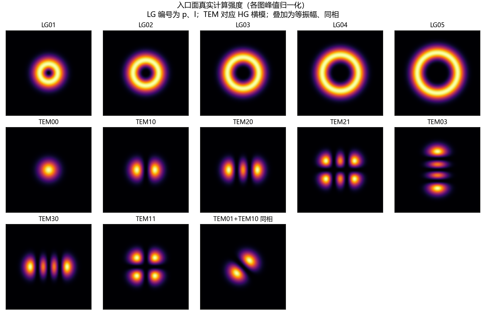

# LG/TEM、光斑显示与磁盘缓存验证

日期：2026-11-23。适用于当前源码 `启动软件.cmd`，历史便携包未重打。此项更新继续保留像素中心对齐、自适应焦区与原始计算，不用绘图替代物理求解。

## 模式与显示

用户确认的预设为 LG01、LG02、LG03、LG04、LG05、TEM00、TEM10、TEM20、TEM21、TEM03、TEM30、TEM11、TEM01+TEM10。LG 两位为径向 p、方位 l，五个预设分别为 p=0、l=1—5；TEM 以 HG 标量横模表示，第一位沿 x、第二位沿 y。不是矢量 TM 波导模型。旧 HG/LG 自定义表仍可编辑振幅、相位和阶数。

图为 512 网格、3 mm 窗口、0.45 mm 束腰的入口面计算；各图独立峰值归一化，不是聚焦后的形状或功率比较。TEM01+TEM10 默认为等振幅、同相斜向双瓣；第二行相位 90° 时交叉项改变并形成环形强度。测试验证每个预设的映射、归一功率、LG 相位绕转、TEM03/30 互为转置及相干相位。

上一轮把二维光斑固定为最近邻原始像素，焦区放大后采样格尤其明显；自动预览仅 256/33，也会缺少细节。本轮默认 bilinear 视觉插值，并增加“原始像素”开关；两者使用同一原始数组、物理 extent 和焦区范围。平滑不增加精度，欠采样提示保留。图片导出固定调用时的平滑选项，鼠标读数和曲线仍来自采样数据。

## 内存原因与实现

完整 float32 强度体积为 `(均匀面与元件面去重后的面数+1)×N²×4` 字节。最后一面为细化焦点预留。网格翻倍为 4 倍，轴向翻倍约为 2 倍；2048/65 结果即为 1,107,296,256 字节（1056 MiB）。复数场/频谱、FFT、坐标与半径排序、元件区段、图形和既有结果另计。3D 并非这部分结果体积的来源。

新项目默认自动存储：超过结果 RAM 预算后使用完整分辨率磁盘映射，RAM 或磁盘也可明确指定并随项目保存。磁盘空间预检额外保留 256 MiB，不能保证后续其他进程不占满磁盘；I/O 错误仍会作为任务失败显示。最多约 64 MiB 写入批次后 flush/重映射，结果发布后不再主动关闭其活动视图；共享所有者在最后一个切片/结果释放后清理文件。强制终止可能留下临时文件，不保证断电恢复。

预算只管理结果存储。文件页缓存由操作系统管理，浏览全体平面仍可能提高工作集；FFT/场缓存不会转存，无法承诺整个进程只用 64 MiB。最高 4096/2049 仅通过配置与估算验证，未进行最高组合完整计算；约 128 GiB 的文件要求及计算工作区仍可能超过设备能力。

## 实际测量与测试

独立无图形进程，CPU、N=2048、65 个均匀面、单透镜默认参数、2 级焦区细化、384 MiB 预算、自动存储：

| 项目 | 本机实测 |
| --- | ---: |
| 完成强度形状 | 66×2048×2048 |
| 映射文件及预测结果体积 | 1,107,296,256 字节 |
| 计算耗时 | 27.46 s |
| 启动后工作集 | 54.2 MiB |
| 50 ms 采样得到的最高工作集 | 819.1 MiB |
| 完成后工作集（读取焦面前） | 55.8 MiB |
| 最后引用释放后临时文件 | 已删除 |

实测峰值包含 CPU 工作区，采样可能漏掉短时峰值，不是 RAM 硬上限或所有机器的承诺。没有同参数 RAM 峰值对照，不能将 1056 MiB 文件直接减去实测峰值当作节省量。原始记录为忽略目录 `outputs/modes-storage-2048-proof.json`；不是实体光学实验。

内核与新增存储测试 **74 项通过**（10.71 s），聚焦界面测试 **4 项通过**（13.07 s）。验证包含磁盘与 RAM 强度、轴向与 r86 逐元素一致，焦面插入每面重映射、切片存活、取消及空间不足清理、超 32 MiB 预算的 641 面真实求解。界面验证覆盖全部预设、平滑切换不改数据/触发重算、保存往返、自动磁盘后台线程和高采样控件。

实现未复制第三方源码，使用已有 NumPy/Matplotlib；原理参考见 [调研记录](research.md)。

最终完整回归 **163 项通过、0 跳过**（74.15 s），包括 7 项真实 CUDA 测试、GUI、独立光学对照与文档检查。CuPy 输出 CUDA_PATH 未检测到的提示，但实际 GPU 计算全部通过；没有用跳过替代验证。干净提交快照文档/中文检查 18 项通过（0.84 s）；后续补充本条记录后再检查文档。
