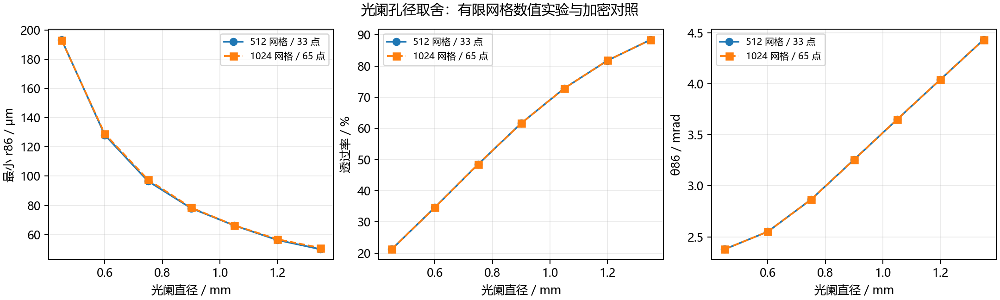

# 数值增强验证与当前验收记录

日期：2026-11-14。算法标识：`fresnel-focus-v2`。关联提交主题：`feat: 完善焦区搜索与多指标数值验证`。本记录对应增强源码；既有 V0.1.0 EXE、发布附件和历史验证结果保持版本对应关系，本次尚未重建或上传发行包。

## 1. 已实现的改进

- 焦区采用轴向粗搜索、解析候选探测与局部离散细化；候选探测仅决定进一步计算位置，最终半径来自实际衍射场。对等值最低平台选代表位置并记录括区宽，边界平台给出警告。细化可关闭。
- 收敛检查分开比较加密网格、等 dx 扩大窗口与轴向采样/细化；记录末端与焦区 r86、焦点位置、θ86、透过率和焦面峰值归一化剖面。
- 新增包围能量图和焦面能量 CSV；结果元数据包含定义、输入、参考束腰、警告、计算环境、时间、源码版本与 SHA-256。只有输入、算法与加载源码摘要匹配的收敛报告才会附入结果。
- 参数扫描区分 ok、warning、error，保留焦区括宽。收敛任务不再把保留的主场景描述为当前检查结果。
- 强度体预分配，复用半径排序，按需加入一个细化观察面；结果体积校验包含额外平面。384 MiB 仍是结果体积限制，不能解释为进程峰值上限。
- 增加固定版本 LightPipes 对照依赖、可复现实验脚本与持续测试配置。

## 2. 短焦距基准

输入：λ=632.8 nm，w0=0.45 mm，入口为束腰，透镜 z=100 mm、f=40 mm；长度 180 mm，窗口 3 mm，网格 1024，轴向 17 点，默认细化 2 级。该配置专门保证较充分的横向采样，与前期 6 mm/512/400 mm 的问题复核配置不同，不能把两者数值直接称为同配置提升。

| 方法 | 最小 r86/μm | 全局 z/mm |
| --- | --- | --- |
| 关闭细化 | 59.3217 | 135.0000 |
| 局部细化 | 17.8206 | 140.0977 |
| 连续解析参考 | 17.7207 | 140.0946 |

细化半径与解析参考的相对差异为 0.5636%；焦区括宽约 1.0547 mm，横向 dx≈2.93 μm。该括宽描述数值搜索区间，并非统计置信区间或严格误差上界。当前固定基准要求半径误差小于 5%、位置误差小于 1 mm；不推广到任意光路。

## 3. 独立衍射对照

使用 LightPipes==2.1.5 的 Fresnel 卷积传播；本项目使用频域传递函数传播。显式配置相同的初始高斯振幅、λ、SI 坐标、薄透镜与圆孔，已断言两库横坐标一致，外部场使用 Begin 后赋振幅以避免解析快捷分支。未复制第三方算法源码。

公共输入：窗口 4 mm，传播长度 220 mm，w0=0.45 mm，λ=632.8 nm，轴向 17 点；透镜 z=100 mm/f=120 mm；需要光阑时置于 z=30 mm、直径 0.9 mm。比较末端面归一化二维强度、r86 和输入归一化透过率。

| 案例 | 网格 | 强度 L1 差异 | r86 相对差异 | 透过率绝对差异 |
| --- | --- | --- | --- | --- |
| 自由传播 | 512 | 0.00352 | 0.233% | 0.00157 |
| 单透镜 | 512 | 0.03160 | 1.005% | 0.01264 |
| 光阑与透镜 | 512 | 0.03115 | 0.000% | 0.01083 |
| 自由传播 | 1024 | 0.00353 | 0.262% | 0.00172 |
| 单透镜 | 1024 | 0.02003 | 0.000% | 0.00180 |
| 光阑与透镜 | 1024 | 0.03181 | 0.000% | 0.00313 |

固定测试阈值为 L1<0.08、r86 相对差异<5%、透过率绝对差异<0.04。L1 是两组单位总和强度分布逐像素绝对差的求和，不是每个像素的相对误差。两种离散传播都存在误差；例如光阑案例加密后 L1 并未单调降低，不能据此声称全面收敛或外部库是真值。

## 4. 多指标收敛与孔径取舍

归档含基准 N=256、L=6 mm、33 点聚焦案例的四组分轴结果。网格加密时，最小 r86 可以完全相同，而焦点位置仍改变约 1.3672 mm；这说明必须同时检查坐标与半径。剖面比较使用各自数值焦面、同一物理横坐标和峰值归一化，不等同于同一固定 z 面的绝对强度。

孔径实验：λ=632.8 nm，w0=0.65 mm，光阑 z=60 mm，透镜 z=100 mm/f=120 mm，长度 280 mm，窗口 4 mm；7 个直径从 0.45 到 1.35 mm。基准 N=512、33 点/2 级；加密 N=1024、65 点/3 级。加密同时改变横向和轴向，是逐点补充对照；分离误差来源使用前述四组检查。

| 光阑直径/mm | 基准最小 r86/μm | 透过率/% | θ86/mrad | 加密 r86 变化/% |
| --- | --- | --- | --- | --- |
| 0.45 | 193.271 | 21.260 | 2.3783 | 0.164 |
| 0.60 | 128.135 | 34.695 | 2.5509 | 0.602 |
| 0.75 | 96.635 | 48.460 | 2.8651 | 1.057 |
| 0.90 | 78.125 | 61.647 | 3.2575 | 0.499 |
| 1.05 | 66.291 | 72.861 | 3.6523 | 0.173 |
| 1.20 | 56.337 | 81.754 | 4.0426 | 0.957 |
| 1.35 | 50.024 | 88.428 | 4.4324 | 1.813 |

本组加密最小 r86 最大变化约 1.813%。θ86 在本次加密后相同；固定窗口下角谱的角度间距没有改善，零变化不能证明远场误差为零。完整记录保留 r50、r95 与 2r86 内能量，用于分析外侧能量分布，不把它们称为标准 M² 或通用旁瓣评价。

本组孔径增大，透过率上升、最小 r86 下降，同时 θ86 上升。θ86 描述整套含透镜系统的出射角谱，不能用单独光阑自由衍射的直觉直接替代；应结合薄透镜聚焦与场分布解释。该趋势仅是当前输入的实测数值现象，不构成通用单调定律。



## 5. 内存与性能记录

使用独立 Python 子进程读取操作系统峰值工作集，包含解释器、依赖、光场、强度和 FFT 临时分配。下表为 N=256/512/1024、33 个均匀轴向点的聚焦案例；实际平面数包括元件与细化面。时间为单次本机记录，测试时可能有其他任务，不能当作性能保证。

| N | 实际平面数 | 结果强度体/MiB | 进程峰值/MiB | simulate 单次/s |
| --- | --- | --- | --- | --- |
| 256 | 34 | 8.50 | 74.10 | 0.433 |
| 512 | 34 | 34.00 | 127.31 | 1.625 |
| 1024 | 34 | 136.00 | 341.68 | 6.485 |

本次没有执行改动前的相同进程峰值基准，因此不能给出实测内存降低百分比。预分配消除了图像列表转整块数组这一重复分配，实际峰值仍随配置与依赖变化。硬件/系统标识保存在 JSON；未获取的硬件参数不补造。

## 6. 复现与验证

```powershell
.\.venv\Scripts\python.exe -m pip install -r requirements-validation.txt
.\.venv\Scripts\python.exe -m pytest tests -q
.\.venv\Scripts\python.exe scripts/validate_numerics.py
& .\tests\Test-Agents.ps1
.\.venv\Scripts\python.exe -m pip check
git diff --check
```

原始记录：[numerical-validation-v2.json](numerical-validation-v2.json)。脚本默认输出到 outputs，避免覆盖既有归档。归档产生于提交前，因此 source_revision 为检查基线、source_dirty 为 true；同一记录还保存实际加载内核源码 SHA-256，后续由当前唯一提交主题追溯对应改动。

核心测试已覆盖短焦距解析对照、光阑位于末片透镜之后的细化面一致性、取消、能量曲线、收敛分轴、过期报告隔离及冻结环境缺失源码。真实 Qt/VTK 测试覆盖新增能量图与结果导出。最终完整测试为 66 passed in 41.27s，进程退出码 0；Test-Agents.ps1、pip check 与差异空白检查通过。最小窗口下参数区滚动可达性已验证；完整过程见开发台账。

## 7. 限制与尚未完成事项

- 局部细化不能保证找到任意多峰光路的全局连续最小值；硬孔径、多峰、低分辨率或边界平台需要人工复核。
- θ86 对频率分辨率敏感；当前没有给所有扫描点分别执行扩大窗口的完整独立收敛链。
- 没有实体光学实验、标准 M²、像差、高 NA、偏振或跨设备精度认证；无损功率守恒不能排除周期回绕。
- 持续测试工作流已写入仓库，但尚未推送运行；图形作业需可用渲染环境，远端是否可用尚未验证。
- Windows COM 0x8001010d 环境诊断仍待处理，不能以隐藏诊断代替检查进程退出码。
- 本次增强通过源码启动器运行，历史 EXE 仍为首版；新配置增加 focus_refinement，旧配置可加载，旧 EXE 不保证读取新字段。
- 正式论文的文献格式、学校验收要求和辅助工具披露仍需按实际要求核对。
