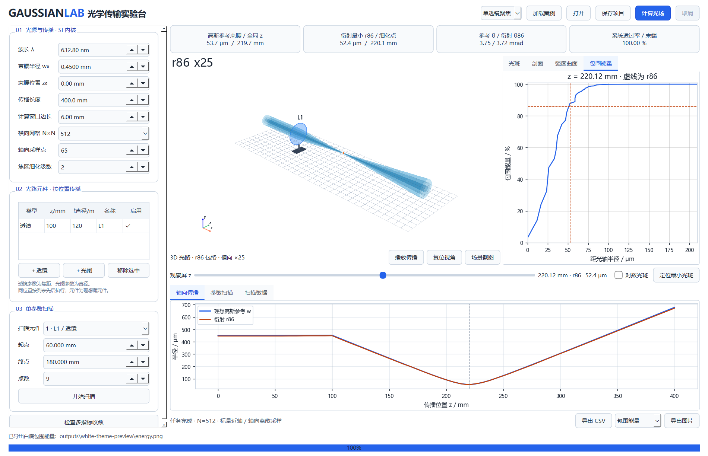

# GaussianLab 项目学习手册

本手册面向刚开始学习 Python、光学仿真和桌面应用开发的读者。目标是能够运行应用、看懂项目文件、说明计算过程、理解测试证据，并对技术问题给出有依据的解释。

当前应用版本为 V3.0.0；白色主题与图像导出来源为 `853e9b3`，数值增强来源为 `4179468`，CUDA/响应式预览源自 `a2a7363`。运行见 [V3 便携指南](USER_GUIDE-v3.0.0.md) 和 [发行验证](release-validation-v3.0.0.md)。V2.0.0 与 V0.1.0 保留为历史版本，旧记录按原版本阅读。快速操作见 [当前使用说明](USER_GUIDE.md)。

当前 V3.0.0 将 CUDA/响应式预览分支整理为正式便携版，包含区段频谱复用、自动预览和会话缓存；V2.0.0 历史文件保留。前次 CUDA 试验回退见 [开发记录 DEV-013](development-log.md)。实现与性能见 [加速说明](acceleration.md)，当前分发与首次 CUDA 联网补充说明见 [V3 指南](USER_GUIDE-v3.0.0.md)。

阅读证据时区分三种口径：validation-v2.md 是数值增强阶段的物理对照；acceleration-validation.json 和 interaction-validation.json 是开发分支固定场景的性能记录；github-release-v3.0.0.json 与 github-release-smoke-v3.0.0.json 是正式远端附件的摘要和 CPU/CUDA 冻结检查。它们不能互相替代。已发布 ZIP 内的手册是构建时快照，仓库内手册与离线 HTML 随文档维护更新。

## 1 项目解决什么问题

GaussianLab 是一个简单光学系统中的高斯光束传播与光斑分析应用。用户设置光源、透镜、光阑和距离，应用计算光束沿光路的变化，并通过三维光路、二维光斑、剖面、曲线和数据表展示结果。

可以把一次计算理解为四个步骤：准备光源和光路；按照位置依次传播光场；从光场提取半径、能量和远场指标；把结果交给界面显示和导出。

| 已实现能力 | 具体含义 |
| --- | --- |
| 多透镜 | 按轴向位置组合多片理想薄透镜，允许负焦距 |
| 圆形光阑 | 在复光场上施加圆孔遮罩，再继续计算衍射 |
| 解析参考 | 使用 q 参数和 ABCD 方法计算理想高斯光束 |
| 数值传播 | 使用二维快速傅里叶变换计算标量近轴菲涅耳传播 |
| 光斑分析 | 显示高斯参考半径、包围能量曲线、r86、相对透过率和远场角度 |
| 参数扫描 | 改变指定透镜焦距或指定光阑直径，逐点重复计算 |
| 可视化 | 三维轮廓、观察屏、二维强度、剖面与强度曲面 |
| 图片导出 | 六类分析图支持白底 PNG/SVG/PDF，PNG 为 300 dpi |
| 保存发布 | 保存项目与结果快照；已发布便携包保持历史版本 |

当前模型使用空气、单色、同轴、近轴、理想薄透镜和圆形硬光阑。高数值孔径矢量聚焦、复杂像差、偏振、非线性介质和标准 M² 分析不在当前实现范围。

阶段检查与后续验证建议见 [项目检查与改进建议](project-review-2026-11-14.md)。其中记录短焦距下的轴向漏采风险；完整测试通过不代表任意参数精度认证。焦区细化、多指标收敛和独立衍射对照已在源码实现，实际证据和剩余限制见 [数值增强验证](validation-v2.md)。V2.0.0 的便携版本另行验证，不覆盖旧附件。



## 2 建议的学习顺序

第一轮只学习操作和概念：阅读第 3—7 章，运行三个预置案例，解释输入和输出的单位，区分单次计算与扫描。完成标志是能自己生成曲线和扫描数据。

第二轮学习计算：阅读第 8—12 章，先看 `model.py`，再看 `optics.py`，用纸笔核对自由传播与薄透镜公式。完成标志是能解释为什么需要两种计算方法，以及误差可能来自哪里。

第三轮学习软件：阅读第 13—18 章，沿着一个按钮追踪线程、结果和图表。完成标志是能够指出“输入在哪读取、计算在哪完成、显示在哪更新”。

第四轮学习验证和表达：阅读第 19—22 章，用测试与限制支持自己的说明。遇到尚未实现的功能，应明确说明当前范围，再提出可行的改进方向。

## 3 如何运行应用

### 3.1 使用便携版

下载或复制 `GaussianLab-v3.0.0-Windows-x64.zip`，完整解压后运行 `GaussianLab.exe`。同级 `_internal` 是随附运行库，不能只复制可执行文件。此方式不要求用户安装 Python。

当前本机运行包位于 releases/v3.0.0；无需 Python、完整 CUDA Toolkit 或虚拟环境。首次 CUDA 需联网补齐约 3.6 MB 官方头文件并缓存随包组件，失败时使用 CPU；详细路径与空间要求见 V3 指南。目标为 Windows 10/11 x64，实际环境为本机 Windows 11；隔离开发路径不等于已经跨全部实体设备验证。

### 3.2 从源码运行

在项目根目录执行：

```powershell
.\.venv\Scripts\python.exe -m gaussian_lab
```

也可以使用 `启动软件.cmd` 或 `启动软件.ps1`。它们都定位本项目的虚拟环境，再调用模块入口。

`.venv` 是本项目自己的解释器和依赖环境。系统 Python 与 `.venv` 可能不是同一个版本；开发命令应明确使用 `.venv\Scripts\python.exe`。当前已验证环境采用 Python 3.10.11，早期设计提出的 Python 3.12 并未作为实际构建环境。

### 3.3 找不到模块时

先检查命令是否在项目根目录执行，是否使用了正确的虚拟环境，再检查依赖。不要直接把“找不到模块”当作算法错误。

```powershell
.\.venv\Scripts\python.exe -m pip check
.\.venv\Scripts\python.exe -m pip list
```

已有环境无需反复安装。新环境的安装方式见 README；版本快照适用于已验证组合，跨平台运行应重新验证。

## 4 看懂界面与一轮操作

### 4.1 各区域的职责

| 界面区域 | 作用 | 注意事项 |
| --- | --- | --- |
| 光源与传播 | 波长、束腰、位置、传播范围、窗口和网格 | 长度与角度显示单位不等于内部存储单位 |
| 光路元件 | 编辑透镜和光阑的类型、位置、参数及启用状态 | 透镜参数是焦距，光阑参数是直径 |
| 三维主视图 | 查看包络、元件、焦点和观察屏 | 横向放大 25 倍，元件形状为示意 |
| 光斑分析标签 | 切换二维光斑、剖面、强度曲面与包围能量 | 峰值归一化图不能用于直接比较绝对功率 |
| 轴向传播 | 展示尺寸随 z 的变化 | 高斯 w 与衍射 r86 的定义不同 |
| 参数扫描 | 展示逐点改变参数后的曲线 | 需要单独运行扫描任务 |
| 扫描数据 | 列出参数、尺寸、位置、透过率、状态及说明 | 先单独运行参数扫描 |
| 导出图像类型 / 导出图片 | 指定右上分析图或下方轴向、扫描曲线 | 默认“当前分析图”指右上当前标签 |

### 4.2 完成第一次计算

1. 顶部选择“单透镜聚焦”，点击“加载案例”。
2. 观察透镜后的光束收缩，以及包络达到最小值后重新展开。
3. 点击“定位最小光斑”，读取当前位置与 r86。
4. 移动观察屏，观察二维光斑、剖面和曲线游标共同变化。
5. 将透镜焦距从 120 mm 改成另一合理值，点击“计算光场”，再比较结果。

改动输入后，旧图仍保留并标为旧参数；V3 默认停止输入 400 ms 后计算快速预览。预览最多 N=256、33 个轴向点且不做焦区细化；完整结果需要点击“计算光场”。连续输入取消旧光场任务，旧版本完成信号不会覆盖新输入；扫描和收敛仍手动触发。

### 4.3 为什么两个扫描页可能为空

顶部“计算光场”只计算当前一组参数。左侧“开始扫描”才会读取扫描元件、起点、终点和点数，执行多个参数点。“检查多指标收敛”也不是参数扫描。

例如选择 L1，起点 60 mm、终点 180 mm、9 点，再点击“开始扫描”。等待“扫描完成”后，曲线和数据表才会生成。V0.1.0 在首次扫描前缺少引导，这是界面可发现性的限制，不能据此断言计算模块不存在。

### 4.4 完成第一次图片导出

1. 完成计算，移动观察屏到所需位置。
2. 右下选择“剖面强度曲线”，点击“导出图片”，保存为 PNG。
3. 不必切换分析标签，直接选择“包围能量”再导出，核对两图标题的 z 一致。
4. 需要下方曲线时选择“轴向传播”或“参数扫描”，避免误用“当前分析图”。
5. 结合第 17.3 节保留对应参数快照，并区分图片输出 dpi 与计算网格。

## 5 光学基础词汇

### 5.1 波长与相干光

波长 λ 表示光波在一个周期内传播的距离。本项目的单色光源只有一个波长，常用 632.8 nm 作为示例。相干传播需要保留光场的相位，才能计算不同位置传播来的波如何叠加。

### 5.2 光场与光强

光场 E 是复数，可以同时表示振幅和相位。光强与其模平方成正比，即 `I = |E|²`。本项目用二维复数数组表示一个横截面，数组的每个元素对应一个空间采样点。

只知道光强还不足以继续准确传播，因为不同相位的光场可以具有相同光强，却在后续传播中形成不同分布。

### 5.3 束腰与瑞利长度

束腰是理想高斯光束最细的位置，w0 是该处半径。瑞利长度 zR 描述束腰附近变化的距离尺度。在束腰前后一个瑞利长度处，半径增大到束腰半径的 √2 倍。

### 5.4 薄透镜与焦距

理想薄透镜忽略厚度和像差，用焦距描述聚散作用。正焦距通常用于会聚，负焦距用于发散。高斯光束经过透镜后的束腰位置由入射曲率和瑞利长度共同决定，通常不能直接说“束腰一定在透镜后一个焦距”。

### 5.5 光阑、截断与衍射

圆孔光阑保留孔内光场、遮挡孔外光场。截断后光场一般不再严格保持高斯形式，其传播可形成环和旁瓣。缩小孔径会减少通过能量，也可能加宽远场分布；不能简单地把所有后续光斑都画得更细。

## 6 单位与符号对照

| 名称 | 符号或字段 | 内部单位 | 常用显示 |
| --- | --- | --- | --- |
| 波长 | wavelength / λ | m | nm |
| 束腰半径 | waist / w0 | m | mm、μm |
| 束腰位置 | waist_z | m | mm |
| 元件位置 | Element.z | m | mm |
| 透镜焦距 | Element.value，类型为 lens | m | mm |
| 光阑直径 | Element.value，类型为 aperture | m | mm |
| 观察位置 | Result.z | m | mm |
| 发散半角 | divergence、theta86 | rad | mrad |
| 强度数组 | intensity | 相对量 | 归一化图像或分贝图 |
| 系统透过率 | transmission | 无量纲 | % |

换算：`1 mm = 10⁻³ m`，`1 μm = 10⁻⁶ m`，`1 nm = 10⁻⁹ m`，`1 mrad = 10⁻³ rad`。界面读取输入时转换为国际单位制，显示和导出时明确单位。

半径与直径不同：`直径 = 2 × 半径`。光源束腰输入半径，光阑输入直径；这两个控件不能混用。

## 7 正确理解输出指标

### 7.1 高斯半径 w 与直径 2w

理想高斯光束的强度分布为 `I(r) = I0 exp(-2r²/w²)`。r=w 时，强度降为峰值的 1/e²，约 13.5%。因此 w 是按强度阈值定义的半径。

### 7.2 包围能量半径 r86

r86 是围绕光斑中心累计到该面总能量 86% 时的半径。它关注能量的集中程度，可以用于具有衍射环的圆对称光斑。

理想高斯光斑中，半径 r 内的能量比例为 `1-exp(-2r²/w²)`，所以 `r86 = w sqrt[-ln(0.14)/2] ≈ 0.9915w`。两者接近，但定义不相同；截断后不应继续套用这个换算关系。

本项目以固定光轴中心统计能量，没有实现任意偏心、非对称光斑的自动质心定位分析。

### 7.3 发散半角与远场能量角

理想高斯参考发散半角为 θ，θ86 是远场角分布中包含 86% 能量的角半径。界面默认用半角，不是全角；高斯全角为 2θ。

θ86 由角谱计算，不是把截断后光斑强行拟合为高斯再套公式。有限频率采样与窗口都会影响结果。

### 7.4 数值焦点与透过率

数值焦点在末片透镜之后搜索；没有透镜时从入口开始。先计算轴向粗网格，再对最低平台邻域按级细化，并将选定观察面加入结果数组。解析束腰仅用于额外探测，不代替衍射结果。横向 r86 为离散分位值，同值平台以中心附近作为代表；括区宽不是严格误差界，多峰和硬光阑仍需复核。焦区细化级数可设为 0—4，0 保留粗搜索。左侧参数区域支持滚动，较小窗口下仍可访问扫描和收敛按钮。

透过率是当前面能量相对于输入面能量的比值。在同一均匀网格上，离散强度求和中的采样面积因子会相消。程序未提供输入功率设置，因而不应把归一化强度读作 W/m²。

## 8 解析高斯传播如何计算

### 8.1 q 参数的作用

q 是把光束曲率和光斑尺寸合并表示的复数参数。空气中有：

```text
q(z) = z - z_w + i z_R
z_R = π w0² / λ
1/q = 1/R - i λ/(π w²)
```

入口位于 z=0，束腰位于 z_w 时，初始 q 为 `-z_w + i z_R`。q 的实部可以描述相对束腰的轴向距离，虚部为瑞利长度。

### 8.2 自由传播与薄透镜

```text
自由传播距离 d：q_out = q_in + d
经过焦距 f 的薄透镜：1/q_out = 1/q_in - 1/f
```

`q_initial()` 构造入口参数，`analytic()` 按位置逐段处理光路，`radius()` 从 q 提取半径，`output_gaussian()` 给出末个启用元件后的参考束腰和发散角。

### 8.3 ABCD 矩阵与执行顺序

```text
自由空间：P(d) = [[1, d], [0, 1]]
薄透镜：L(f) = [[1, 0], [-1/f, 1]]
一般变换：q_out = (A q_in + B)/(C q_in + D)
```

先经过 P 再经过 L 时，总矩阵为 `L × P`。多元件情况下，矩阵顺序错误会改变物理结果。当前实现逐元件更新 q；测试中另用显式矩阵乘法进行对照。

### 8.4 从末端参数求束腰

在末元件位置 z_last 得到 q 后，参考束腰位置为 `z_last - Re(q)`，参考半径为 `sqrt[λ Im(q)/π]`。空气中远场半角为 `λ/(πw0)`。

这些是理想高斯参考。光阑不会进入 q 的高斯形式改变计算，因此光阑截断后的真实尺寸由数值分支给出。

## 9 数值衍射如何计算

### 9.1 建立二维网格

计算窗口边长为 L，网格数为 N，每个方向的采样间距为 `dx=L/N`。坐标采用中心对称排列，二维数组覆盖一个有限横截面。

默认 `L=6 mm、N=512`，所以 `dx≈11.72 μm`。若最小半径只有约 30 μm，只相当于几个采样间隔，尺寸读数会有明显离散影响，需要加密网格。

### 9.2 构造入射场

`initial_field()` 由入口 q 提取半径与曲率，生成高斯振幅和二次相位。振幅使用 `exp(-r²/w²)`，光强是模平方，因此光强中的指数系数为 2。

### 9.3 透镜与光阑作用

理想薄透镜乘上相位因子：

```text
E_out(x,y) = E_in(x,y) exp[-i π(x²+y²)/(λ f)]
```

光阑直径为 D 时，半径 a=D/2；圆孔内保留光场，孔外设为零。它改变振幅分布，之后必须继续进行波动传播。

### 9.4 菲涅耳（Fresnel）频域传播

`fresnel()` 先对复光场做二维傅里叶变换，再乘上传递函数，最后做逆变换：

```text
H(fx,fy,d) = exp[-i π λ d(fx²+fy²)]
E_out = IFFT2[FFT2(E_in) × H]
```

这里省略了不影响当前强度分析的整体传播相位。函数使用近轴菲涅耳模型，不是保留全部角度项的精确矢量传播。

### 9.5 一次 simulate 的完整顺序

1. 复制并校验 Project，防止计算中输入被修改。
2. 创建网格、半径数组和初始复光场，记录输入能量。
3. 生成轴向采样位置，并补入启用元件的准确位置；局部细化后加入选定焦面。
4. 按距离向前传播，到元件位置后依次施加相位或遮罩。
5. 每个面计算强度、r86、相对透过率和边界诊断。
6. 从末个元件后的光场角谱计算 θ86，独立计算理想高斯参考。
7. 将数据封装为 Result，再交给界面与文件输出。

同一位置的多个元件按原列表顺序执行；轴向排序是稳定的。程序不支持向负距离反向传播，零距离返回副本以避免共享数据被意外修改。

## 10 远场与能量指标的实现

`encircled_radius()` 将各采样点按到光轴的距离排序；同一仿真复用半径排序以避免逐平面重复排序，再累计强度，再找到达到指定能量比例的采样点半径。这是一种离散分位点估计，没有进行连续空间积分插值。

远场角谱来自末个启用元件之后的复光场。对频率网格进行中心化排列，并用近轴关系 `角度≈λ×空间频率` 转换到角坐标，再对角谱强度计算 86% 包围能量角。

光阑之前若输入仍为同轴高斯，可以使用圆孔透过率解析基准：

```text
T = 1 - exp(-2 a²/w²)
```

该式用于测试圆孔对入射高斯的截断，不适用于任意多光阑之后的非高斯场。后续能量应由实际场积分统计。

结果导出现在同时保存 `.csv.meta.json` 与 `.energy.csv`：前者包含算法标识、加载时的内核源码 SHA-256、输入、指标、警告和匹配的收敛报告；后者为焦面包围能量曲线。源码或输入不同的收敛报告不会混入结果。冻结环境没有独立源码时摘要可为未知。新配置增加 `focus_refinement` 字段，旧配置仍可读取；历史便携版不保证读取增强源码保存的新字段。

## 11 误差与收敛需要怎样理解

### 11.1 三种不同的分辨率问题

横向网格控制光斑细节，窗口控制横截面覆盖范围，轴向采样控制焦点位置搜索。增加轴向点数不能补救横向欠采样；仅扩大窗口而 N 不变还会增大 dx，使小光斑更难分辨。

### 11.2 周期窗口与混叠

快速傅里叶变换将离散窗口按周期处理。光场传播到边界后可能从另一侧回绕，有限角谱范围也可能截去重要成分。边缘能量较小是诊断信号，不能独立证明全部误差很小。

### 11.3 当前收敛按钮实际做什么

`convergence()` 进行四组计算：基准；固定窗口加倍 N；同时加倍 N 与 L、保持原 dx 扩大窗口；保持横向设置、增加轴向点数与焦区细化级数。所有配置先校验再计算，避免中途才遇到体积限制。

分别报告末端 r86、最小 r86、焦点位置、θ86、透过率及焦面剖面变化。剖面在相同物理横坐标比较，各自采用搜索得到的焦面和峰值归一化；不是同一固定 z 的绝对强度比较。离散半径不变仍可能伴随焦点位置移动，零变化不等于零误差。软件不会自动将检查标为通过。

### 11.4 当前警告的意义

| 警告 | 可能原因 | 处理方向 |
| --- | --- | --- |
| 光斑不足几个像素 | 横向采样偏粗 | 增加 N，复核 L 的选择 |
| 孔径像素过少 | 圆孔边界离散粗糙 | 加密网格并比较透过率 |
| 边界能量偏高 | 窗口截断或周期回绕 | 扩大窗口，同时保持足够密采样 |
| 角谱接近边界 | 远场采样覆盖不足 | 调整 dx 和窗口，比较远场指标 |
| 最小点位于区间末端 | 搜索范围可能不够 | 扩大传播区间并检查包络 |

这些阈值是工程诊断规则，不是严格误差上界。当前左边界最小点的专门提示、连续焦点优化和完整多指标收敛仍可完善。

## 12 三个案例怎样解读

### 12.1 单透镜聚焦

示例波长 632.8 nm、初始半径 0.45 mm、透镜位置 100 mm、焦距 120 mm。既有验证中，参考束腰约为 53.70 μm，位置约为 219.72 mm；离散最小 r86 约为 52.41 μm，位置为 218.75 mm。

w 与 r86 的定义不同，不能把它们直接相减称为误差。位置差还与轴向采样有关。应分别比较同一定义下的解析值和数值值。

### 12.2 双透镜扩束

案例采用焦距 -50 mm 和 150 mm 的两片透镜，间距为 100 mm。几何准直近似下倍率约为 3，但实际高斯光束具有有限瑞利长度，输出还需检查半径与曲率。

程序给出回推束腰可能位于显示范围之外，这不意味着程序算坏；它表示当前输出段的等效束腰在当前观察区间之外。不要为了得到范围内焦点而删除提示。

### 12.3 光阑衍射

案例在透镜前加入直径 0.9 mm 的光阑。既有记录中，系统透过率约为 61.66%，最小 r86 约为 78.61 μm。对数光斑有助于看到较弱的环，但应说明这是归一化显示。

这些数值只对应已保存的案例配置与采样设置。更改光源、距离、窗口或网格后应重新计算，不应把示例数字当作固定结论。

## 13 先看懂软件的整体架构

```text
启动器 / 模块入口 / 冻结入口
               ↓
          gui.py 主窗口
         ↙             ↘
 model.py 参数模型     Job 后台任务
                        ↓
                  optics.py 计算
                        ↓
                   Result 结果
             ↙          ↓          ↘
        scene.py     charts.py     CSV / JSON
        三维场景      分析图表       保存导出

tests/：独立检查上述行为
scripts/：验证、构建、发布和文档维护
docs/：需求、设计、证据和学习资料
```

分层的好处是：计算可以不打开界面单独测试；界面可以更换显示方式而不改传播公式；导出和三维场景可以使用同一份结果，降低数值不一致风险。

## 14 数据模型是怎样组织的

### 14.1 Element 与 Project

`Element` 是单个元件：kind、z、value、label、enabled 分别表示类型、位置、焦距或直径、名称和启用状态。类型值 `lens`、`aperture` 是程序协议标识，保留英文有利于数据兼容。

`Project` 保存整个输入，包括光源、传播长度、窗口、网格、轴向点数、focus_refinement 焦区细化级数和元件列表。数据类让这些参数具备明确结构，避免在界面各处散落无意义的数字。

`validate()` 拒绝非法值；`ordered()` 返回按位置排序的启用元件；`clone()` 经数据转换创建副本，避免扫描逐点修改用户原项目。

### 14.2 Result 的主要字段

| 字段 | 含义 |
| --- | --- |
| project | 生成该结果的参数快照 |
| z、x | 轴向采样与横向坐标 |
| intensity | 多个横截面的强度，形状约为 K×N×N |
| gaussian_w | 理想高斯参考半径曲线 |
| r86 | 数值包围能量半径曲线 |
| transmission | 各平面相对透过率 |
| theta86 | 末端光路对应的远场能量角 |
| reference | 参考束腰、位置、发散半角 |
| warnings | 采样、窗口和搜索范围诊断 |
| focus | 细化焦点、粗最小值、搜索区间、括宽与边界状态 |
| provenance | 计算环境、时间与加载时的内核源码摘要 |

### 14.3 为什么需要参数快照

计算任务执行时用户仍可能改动输入。结果必须说明来自哪组参数，不能直接把新输入与旧图当作对应关系。导出 CSV 时同步保存对应项目配置，就是为了让数据可以复现。

### 14.4 看源码前要认识的 Python 写法

| 写法或概念 | 在本项目中的含义 |
| --- | --- |
| import、from | 导入模块及其中的对象；相对导入前的点表示当前包 |
| def、return | 定义函数并返回结果；先看参数和返回对象，再看函数内部 |
| class、self | 定义一类对象，self 表示当前实例；每个窗口实例拥有自己的状态 |
| @dataclass | 自动生成数据类的初始化等方法；类型标注帮助阅读，不等同于自动检查所有输入 |
| 列表、字典 | 列表保留元件顺序，字典以字段名存取导出信息；下标通常从 0 开始 |
| NumPy 数组 | 批量存储场、强度与坐标；数组乘法通常逐元素，矩阵乘法使用 @ |
| 复数 1j、abs | 1j 是虚数单位；复数模平方得到相对光强，不能直接把复数当强度 |
| try、except、raise | 捕获、处理或主动抛出异常；失败需保留原因，不能伪造成功结果 |
| with | 管理文件等资源，在退出代码块时释放资源 |
| if __name__ == '__main__' | 只在直接运行文件时执行该入口，导入模块时不自动执行 |
| fixture、assert | 测试前准备并清理环境；断言判断实际结果是否符合预期 |
| 信号、槽 | Qt 的事件连接机制；如按钮发出 clicked 信号，连接的处理函数启动任务 |

学习时可以用编辑器的“跳转到定义”和“查找引用”：前者回答函数在哪里实现，后者回答谁在调用它。不要直接在虚拟环境的第三方包中修改代码来修复应用问题。

## 15 界面与线程如何协作

### 15.1 一次按钮点击的链路

以“开始扫描”为例：

```text
scan_button.clicked
  → start_scan()
  → launch_job('scan', 扫描设置)
  → read_project() 读取并校验输入
  → Job.start() 启动线程
  → Job.run() 调用 optics.scan()
  → completed 信号把结果交回主线程
  → job_done() 更新扫描图和表格
```

`progress` 信号更新进度，`failed` 显示错误或取消结果，`finished` 恢复按钮。后台线程只计算，Qt 控件和图形更新放在界面线程。

V3 的 Job 区分 preview 与 simulate，携带原始输入快照、实际预览配置、后端和输入修订号；单个工作线程完成后才处理最新请求。session.py 的会话 LRU 缓存按完整参数、预览/完整类型与请求后端区分，预算 128 MiB，不保存到磁盘。Git 仓库状态在会话首次计算时捕获并注明捕获时间，避免每次预览启动两个子进程；实际计算时间仍逐次记录。

Propagation 为每个元件之后的区段缓存复光场及起点频谱。任意观察面乘传递函数后做逆 FFT，焦区细化复用同一组区段，不再从入口重复执行光路。同位置元件仍按列表顺序执行；不使用取整距离或近似复光场。CUDA 和 CPU 均保持 complex128/float64；返回图像仍沿用 float32。图形优化包括观察面拖动合并、轴向曲线仅移动游标、相同观察面不重建 VTK 网格，以及光路外形与采样面数量相同时复用元件/支架/标签并更新包络点。

### 15.2 为什么不用一个按钮执行所有任务

单次计算、扫描和收敛检查的工作量与含义不同。将它们分开，可以让用户明确选择任务，也避免每次改动都触发大量重复计算。当前不足是旧版没有在空白扫描页明确解释这一点。

### 15.3 取消与资源管理

取消通过线程事件传给计算内核，在采样面、焦区细化探测和参数点之间检查。它不是强行终止任意机器指令，因此不能保证每个时刻都立即返回。

关闭窗口时先取消并等待计算线程，再清理场景。测试中也要正确处理 Qt 的延迟删除事件，避免断言通过后进程却在退出时失败。

## 16 三维显示究竟做了什么

`scene.py` 将 z 放到三维场景的纵向轴，将横向尺寸放大 25 倍。根据 r86 生成轴对称轮廓，放置透镜和光阑示意，再将观察面实际强度映射为颜色。

内部亮芯用于视觉层次，不能当作独立的三维强度测量。透镜厚度、支座和外形是示意，不参与透镜焦距求解。

强度曲面位于 `charts.py`，高度表示相对光强；它不表示光束在空间的路径。旋转相机不会改变计算结果，移动观察屏读取已有采样面也不等于重新求解光场。

操作时将鼠标放在三维区域，滚轮缩放、左键拖动旋转；“复位视角”恢复默认视图。三维白底截图通过“场景截图”保存。

三维展示的数据来自二维横截面传播与轴向采样，没有进行完整三维电磁场求解。这是解释可视化与物理模型关系时必须明确的范围。

## 17 参数扫描与文件保存

### 17.1 扫描做了哪些重复工作

`scan()` 在起止值之间生成等间距参数；每个点复制项目，修改指定元件的 value，调用 simulate，再提取最小尺寸、位置、透过率、角度和警告。其他输入保持固定。

当前图默认显示末片透镜之后重新搜索的最小 r86，不是所有点都在同一个固定屏幕位置测量。做比较时应说明这个口径。扫描失败点使用无效数值和错误状态保留，不静默伪造成功数据。

### 17.2 项目 JSON 与扫描 CSV

项目 JSON 顶层包含 schema_version、units 和 project。版本用于识别格式，units=SI 表明参数采用国际单位制。当前项目文件不保存三维相机、观察屏或全部光场数组。

扫描 CSV 的字段包括 `value_m`、`min_r86_m`、`focus_z_m`、`transmission`、`theta86_rad`、`focus_bracket_m`、`status` 和 `note`。字段名保留英文以保持数据兼容，中文含义可在本手册中查询。

原始项目保存、扫描任务设置与计算结果是不同对象。将数据快照导出到新文件，比根据当前界面临时拼凑参数更可靠。

### 17.3 白色主题与图片导出

软件窗口、分析图和三维背景均为白色，坐标文字采用深色，光斑与观察屏共用低强度白色的色标。颜色变化只影响显示，不改变光学计算与相对强度数据。

在右下“导出图像类型”中选择光斑图、剖面强度曲线、强度曲面、包围能量、轴向传播或参数扫描，然后点击“导出图片”。默认“当前分析图”对应右上当前选中的分析标签；导出下方轴向或扫描曲线时直接指定对应类型。无需预先打开目标标签。

光斑、剖面、曲面与包围能量使用当前观察屏位置；光斑同时遵循“对数光斑”开关。导出读取已完成的结果快照，修改参数但未重算时仍导出原结果。扫描图读取扫描任务快照，尚未扫描时会提示先完成扫描。

支持 300 dpi PNG 以及 SVG/PDF。图纸、坐标区、图例及强度零值采用白底，并明确关闭透明输出；保存时自动计算图像边界并保留留白，避免标题和坐标被裁切。强度曲面中的二维色块或分位曲线台阶反映已有采样，不通过导出插值虚构更高精度。场景截图沿用“场景截图”按钮，以白底 PNG 保存。

`theme.py` 管理绘图背景、文本、线条颜色和共享强度色标；`charts.py` 与 `scene.py` 使用这些设置，`gui.py` 负责白色控件及导出类型选择。V2.0.0 源码与便携版包含白色主题；历史 V0.1.0 便携版保持原版本。

## 18 文件目录应该怎样读

第一次看源码，可以按 `model.py → optics.py → gui.py → charts.py/scene.py → tests/` 的顺序。不要先从打包钩子、虚拟环境或三维库内部源码开始。

| 目录或文件类别 | 是否为应用业务逻辑 | 阅读方式 |
| --- | --- | --- |
| gaussian_lab/ | 是 | 先理解模型与计算，再连接界面 |
| tests/ | 验证逻辑 | 用测试理解输入、输出和边界条件 |
| scripts/ | 开发维护逻辑 | 按验证、构建、发布的顺序理解 |
| docs/ | 需求、说明与证据 | 区分设计基线、历史记录和当前手册 |
| .github/ | 远端构建配置 | 了解在另一台机器上如何复现构建 |
| .idea/ | 本机开发工具配置 | 不参与算法；不同机器可以不存在 |
| .venv/ | 第三方运行环境 | 不应逐文件作为业务源码学习或直接修改 |
| build/、dist/、releases/ | 构建与发行生成物 | 可由受控构建再生成，不能代替源码管理 |
| outputs/ | 运行输出和临时证据 | 查看对应实验，不把临时文件当固定输入 |
| .git/ | 版本历史数据库 | 通过 Git 命令使用，不手工编辑内部对象 |

附录逐项覆盖受版本管理的文件与本手册新增文件。依赖目录和自动生成目录按类别说明，不逐项解释第三方库的内部文件。截图属于历史证据，其中的界面文字可能与当前源码不同。

## 19 如何证明程序在工作

### 19.1 测试分工

`test_independent_optics.py` 在安装可选 LightPipes 后执行独立传播对照；`test_optics.py` 检查物理与数值基准；`test_gui.py` 检查真实 Qt/VTK 和异步交互；`test_project_docs.py` 检查文档一致性；`test_release.py` 检查发行及发布证据；中文规范与手册检查由 `test_text_policy.py` 完成。

测试数量会随开发变化，不把旧日志中的数量写成永久指标。最终结果需要同时看断言结果与进程退出码，不能只看“通过了若干测试”。

```powershell
.\.venv\Scripts\python.exe -m pytest tests -q
& .\tests\Test-Agents.ps1
.\.venv\Scripts\python.exe -m pip check
git diff --check
```

### 19.2 解析基准与独立对照

可以核对束腰处 w=w0，正负瑞利长度处 w=√2w0，圆孔透过率与解析积分相符，数值自由传播趋近高斯公式，以及多透镜顺序与独立矩阵乘法一致。

这类测试的依据来自独立关系，比只断言“程序返回了一个正数”更有意义。但有限案例不能证明所有参数组合都正确。

### 19.3 真实交互与冻结程序

旧扫描测试直接给 job_done 注入数据，能检查表格填充，却不能证明按钮和线程连接正常。因此又增加真实按钮到工作线程再到两个结果页的回归测试。

冻结验证在打包程序内部执行，报告应标记 frozen=true，并实际完成计算、场景截图、保存与导出。已发布附件还经过实际下载、摘要与压缩包检查，再运行下载版可执行文件。

### 19.4 不应夸大的结论

当前验证属于解析对照、数值实验和软件检查，没有实体光学平台的实测数据。不能据此宣称已经与真实实验完全一致、具有商业光学设计软件精度，或完成标准 M² 测量。

## 20 构建 发布与版本管理

### 20.1 三类启动入口

源码模式由 `__main__.py` 调用界面；本机启动脚本帮助定位虚拟环境；冻结发行由 `app_entry.py` 启动并提供错误日志与冒烟入口。

### 20.2 为什么可执行文件旁边还有目录

本项目采用 PyInstaller 的目录式打包。可执行文件包含启动引导，`_internal` 包含 Python、Qt、VTK、数值库和资源。保留独立动态库也便于按第三方许可要求替换兼容库。

### 20.3 打包配置为何要排除部分动态库

构建环境 PATH 中的其他软件可能带入同名但不兼容的动态库。项目曾遇到 Poppler 的 ICU 与 Windows 原生 ICU 接口不一致的问题，已经在配置中排除。无关的 Qt PDF、虚拟键盘和可视化附加模块也被排除。

这些处理来自真实的部署问题，并不改变光学公式。打包失败、界面失败与数值失败应分别定位。

### 20.4 Git 和 GitHub 各自负责什么

Git 保存本地文件历史，commit 对应一次可追踪改动，tag 标识一个版本基线。GitHub 提供远端源码、构建和发行附件。源码仓库、已编译附件与对应源码附件是不同文件，校验值也不可混用。

本项目使用私有仓库。发布脚本通过标准凭据管理器和官方接口访问，不将凭据写入项目。GitHub Actions 使用远端 Windows 环境构建，解决了本机大附件上传过慢的问题。

既有 V0.1.0 标签和附件不随文档编辑自动改变。后续功能或界面更新应形成新的经过验证的版本，不应修改旧摘要后仍把它称为原发布文件。

## 21 常见问题与定位方法

| 现象 | 先检查什么 |
| --- | --- |
| 两个扫描页空白 | 是否运行了左侧“开始扫描”，而非仅计算光场或收敛检查 |
| 修改参数后图未变 | 是否已经重新计算，图是否明确标为旧参数快照 |
| 焦点不在预想位置 | 先检查单位、入射束腰与曲率，再区分透镜焦距和实际束腰位置 |
| 扩束案例没有范围内束腰 | 检查是否为回推束腰，理解显示区间与输出曲率 |
| 光斑看起来有方格或环不平滑 | 检查采样、窗口、归一化和显示插值 |
| 曲线最小值随点数变化 | 轴向采样可能不足，需要局部细化 |
| 数值透过率略高于 1 | 判断是否为浮点舍入量级，不能把明显增能都归为舍入 |
| 同样峰值的图能量不同 | 逐面峰值归一化隐藏了总能量差，检查透过率 |
| 可执行程序无法启动 | 检查完整解压、运行库、系统与图形驱动，再查看启动错误日志 |
| 私有仓库打开显示不存在 | 检查当前账号是否有访问权，不应因此直接改成公开 |
| 测试输出通过却进程失败 | 核对退出码、线程退出和图形资源清理 |

定位时保留输入、版本、网格、窗口、操作步骤和实际错误。先复现，再提出原因，再用验证区分原因，避免只根据一张图猜测。

## 22 技术自测问答

### 22.1 项目为什么选择 Python

Python 便于将 NumPy/SciPy 数组计算、Qt 桌面界面、Matplotlib 图表和 VTK 三维渲染组合起来，也便于编写独立测试。当前没有实现 MATLAB 版本，因此不能声称已验证两种语言结果一致。

### 22.2 解析方法和数值方法为何同时存在

解析方法快速、可解释，适合作为理想高斯参考。硬光阑截断破坏严格高斯形式，需要复光场的数值传播。两者还可在无截断条件下相互核对。

### 22.3 相位为什么重要

透镜主要施加相位变化，传播通过干涉改变后续强度。若每个面只保留强度而丢掉复光场，就无法保持这条物理关系。

### 22.4 程序是不是在做几何光线追迹

高斯参考使用近轴传递关系，数值分支传播的是复光场。三维轮廓不是逐条光线积分，也不是实体镜片中的完整折射追迹。

### 22.5 三维画面是否意味着三维电磁求解

不是。计算对象是二维横截面场和轴向传播，展示层将结果组织成三维场景，并利用圆对称条件生成轮廓。

### 22.6 透镜外形和厚度如何影响结果

当前显示外形是示意，计算只用薄透镜焦距。厚透镜、材料色散、球差等若要纳入，需要扩展元件模型与传播处理。

### 22.7 小孔径为什么有时使远场变宽

孔径限制空间分布，对应频域分布扩展。实际结果还受入射光场和透镜影响，应使用同一配置下的计算和指标比较，而不是对所有场景套一句定性结论。

### 22.8 你如何说明精度

给出模型假设、独立解析基准、参数和网格设置，以及网格/窗口/轴向采样改变后的指标变化。没有这些证据时，只能说得到一个数值结果，不能给出未经标定的精度等级。

### 22.9 为什么不直接输出 M²

标准光束质量因子涉及明确的二阶矩定义和传播分析。硬截断的长尾会导致有限窗口结果敏感，本项目还没有完成对应规范和稳定性验证。

### 22.10 r86 与 w 为什么不完全相同

前者按累计能量定义，后者按高斯强度阈值定义。理想高斯下 r86≈0.9915w；非高斯光斑下不能直接换算。

### 22.11 你如何证明多透镜顺序正确

说明元件按 z 排序、同位置保留列表顺序，再展示与独立 ABCD 矩阵连乘的测试。只展示一张扩束图不能证明实现顺序正确。

### 22.12 计算是否在 GPU 上执行

V3.0.0 正式版提供 NumPy/SciPy CPU 与可选 CuPy CUDA 后端，实际 used 字段和设备型号写入 provenance；不可用时自动回退 CPU。自动模式 N<512 使用 CPU，CUDA 优先允许预览使用显卡。首次 CUDA 缓存和联网补充需要额外时间，不能把预热后的内核计时当作首次响应承诺。VTK 渲染与数值求解分开，看到三维图并不能证明 CUDA 已启用；历史 V2.0.0 保持 CPU 口径。

### 22.13 为什么扫描不会阻塞所有界面操作

较重任务放入 QThread，计算完成后用信号回到主线程更新控件。仍受 CPU、内存和渲染工作量限制，不能承诺所有场景都实时响应。

### 22.14 如何保证导出数据与图对应

Result 保存参数快照，图表读取该结果；导出数据同步保存生成它的项目配置。扫描使用自己的结果和设置，不能误取后来修改的输入。

### 22.15 为什么同一版本的两个构建摘要可能不同

不同机器的打包时间、路径和环境资源可使二进制不同。应区分本机构建清单与远端附件清单，用实际下载文件的摘要核对发布记录。

V3 发布采用“远端构建上传草稿 → 认证下载 → SHA-256/CRC → 本机 CPU 和实际 CUDA 冻结检查 → 正式发布”。云端无 GPU 不作为 CUDA 验收环境，工作流不自动解除草稿；首次 CUDA 官方补充下载也在全新缓存中检查。构建和安装环境统一启用 UTF-8，避免英文 Windows 的 cp1252 误读中文依赖注释。源码重建时可先设置 PYTHONUTF8=1；运行便携 EXE 无需此设置。

### 22.16 是否采用了外部光学库的实现

项目调研了 RayTracing、LightPipes 和 GaussianBeam，但当前 q 参数和菲涅耳计算内核由本项目编写；使用 NumPy/SciPy 完成数组与变换。LightPipes==2.1.5 已用作可选独立对照，不替代产品内核；外部参考、验证依赖与运行依赖分别记录。

### 22.17 是否完成实体实验验证

当前没有实体测量记录。已有证据是解析基准、数值实验、软件测试和独立发行验证；若后续进行实验，应记录仪器、标定、测量误差和对照方法。

### 22.18 项目的不足是什么

当前主要不足包括有限模型范围、局部离散焦点仍有平台与多峰风险、有限窗口误差、没有任意光路精度保证，以及显示状态保存、扫描动画和独立透镜口径等交互功能。多指标收敛、包围能量与独立对照已加入源码，但不能替代实体实验或标准 M² 测量。改进应按影响程度排序并提供验证方法。

### 22.19 下一步如何扩展

当前已有局部焦区细化和多指标收敛；下一步可扩展多峰搜索、逐扫描点的窗口收敛与空白页引导。加入像差或矢量传播时，应同时扩展数据模型、数值方法和独立测试，不能只在界面增加按钮。

### 22.20 一分钟如何介绍这个应用

可以按“问题、方法、实现、验证、限制”组织：应用用于研究简单光路中高斯光束聚焦、扩束和光阑截断；通过 q 参数提供理想参考，通过二维菲涅耳传播计算衍射；桌面界面连接后台任务、三维场景和图表；使用解析基准、数值对照、真实交互与冻结程序验证；当前范围为单色同轴近轴模型，尚无实体实验和标准 M² 验证。

这段说明的重点是让每个结论都能找到代码和证据，而不是背诵术语。

## 23 学习练习与检查点

练习一：在不看界面标签的情况下，解释波长、束腰、焦距、光阑直径各自的含义和单位，并找到对应模型字段。

练习二：从 `start_scan()` 开始，画出调用到 `scan()`、再回到表格更新的流程，并指出线程边界。

练习三：将自由传播设置为无透镜和无光阑，核对束腰处及一个瑞利长度处的半径。保存输入后再解释结果。

练习四：固定光路扫描孔径，比较透过率和最小尺寸，说明测量口径，区分峰值归一化图与能量统计。

练习五：分别改变 N、L 和轴向采样数，记录同一定义的指标，解释哪些变化与采样有关。

练习六：任选一个测试，说明它的独立依据、能发现的错误和不能证明的内容。

补充练习：在同一观察面导出光斑、剖面、强度曲面和包围能量；核对标题 z、归一化方式、单位、白底与完整标签。随后仅改输入而不重算，再解释为什么导出仍属于原快照。

完成后应能回答：哪里是输入、哪里是公式、哪里是离散近似、哪里只是显示、哪里有验证、哪里仍有限制。

## 24 维护手册与中文规范

项目自有注释、文档字符串、面向用户的说明和错误解释使用中文。保留函数名、字段、命令、库名和单位，避免修改文件格式和外部接口。第三方许可原文与原始测试输出是证据或法律文本，解释另写中文。

更新文件后维护 `file-roles.json`，再运行：

```powershell
.\.venv\Scripts\python.exe scripts/build_handbook.py
.\.venv\Scripts\python.exe -m pytest tests -q
```

网页阅读版由 Markdown 源文件生成，提供目录导航，也可在浏览器中打印。不要只修改生成网页而不更新源文件。当前手册是学习与维护文档，不替代库的官方 API 文档或正式物理教材。

## 附录 逐文件用途清单

本表由维护脚本生成。可选本机配置可能不出现在其他机器的干净检出中；它们不参与应用功能。

<!-- FILE_INDEX_START -->
| 文件 | 作用 |
| --- | --- |
| `.github/workflows/checks.yml` | 普通提交的无图形持续测试，以及可手动触发的真实 Qt/VTK 图形回归；不自动发布。 |
| `.github/workflows/release.yml` | 手动触发 Windows 远端构建、检查并上传到草稿；本机下载核验后再独立发布。 |
| `.gitignore` | 排除虚拟环境、构建产物、运行输出及发行目录，避免将大文件与本机缓存提交到源码仓库。 |
| `.idea/.gitignore` | 本机集成开发环境生成文件的忽略规则。 |
| `.idea/inspectionProfiles/Project_Default.xml` | 本机代码检查配置，包含检查工具与忽略包规则。 |
| `.idea/inspectionProfiles/profiles_settings.xml` | 本机代码检查方案的启用设置。 |
| `.idea/modules.xml` | 本机项目模块列表及模块文件引用。 |
| `.idea/vcs.xml` | 本机集成开发环境的 Git 目录映射。 |
| `.idea/毕业设计.iml` | 本机 Python 模块与解释器配置，不参与业务计算和发行运行。 |
| `GaussianLab.spec` | 可执行程序的打包配置，决定入口、资源、动态库、隐藏导入和组件排除。 |
| `README.md` | 项目总入口，说明运行、文档、验证、构建方式及当前能力边界。 |
| `agents.md` | 项目协作、中文注释、提交、测试、开发记录及手册维护规则。 |
| `app_entry.py` | 窗口化发行入口，支持正常运行、冻结冒烟测试和启动失败日志。 |
| `docs/THIRD-PARTY-NOTICES.md` | 发行时使用的中文第三方声明，原始许可证另行随包保留。 |
| `docs/USER_GUIDE-v0.1.0.md` | 历史 V0.1.0 便携版使用说明，保留旧功能操作并链接当前源码指南。 |
| `docs/USER_GUIDE-v2.0.0.md` | V2.0.0 便携版的启动、图像导出、数据、目录保留和故障说明。 |
| `docs/USER_GUIDE-v3.0.0.md` | V3 便携版启动、首次 CUDA 联网补充、缓存、CPU 回退、自动预览及导出说明。 |
| `docs/USER_GUIDE.md` | 当前 V3 操作说明，区分便携初始化与源码安装，覆盖预览/完整计算、导出、扫描和快照。 |
| `docs/acceleration-validation.json` | V2.0.0、优化 CPU、实际 CUDA 与预览的配置、逐次计时及数值偏差。 |
| `docs/acceleration.md` | V3 CUDA/响应式预览实现与使用说明，保留开发阶段性能口径并链接正式发行证据。 |
| `docs/assets/cuda-preview-desktop.png` | CUDA 开发分支真实窗口截图，显示实际后端、光学场景与分析曲线。 |
| `docs/assets/diffraction-desktop.png` | 光阑衍射历史应用界面截图，用于追溯界面与数值展示。 |
| `docs/assets/diffraction-scene.png` | 光阑衍射历史三维场景截图，用于追溯渲染结果。 |
| `docs/assets/diffraction.json` | 光阑衍射预置项目输入参数，采用国际单位制。 |
| `docs/assets/expander-desktop.png` | 双透镜扩束历史应用界面截图，用于追溯界面与数值展示。 |
| `docs/assets/expander-scene.png` | 双透镜扩束历史三维场景截图，用于追溯渲染结果。 |
| `docs/assets/expander.json` | 双透镜扩束预置项目输入参数，采用国际单位制。 |
| `docs/assets/focus-desktop.png` | 单透镜聚焦历史应用界面截图，用于追溯界面与数值展示。 |
| `docs/assets/focus-scene.png` | 单透镜聚焦历史三维场景截图，用于追溯渲染结果。 |
| `docs/assets/focus.json` | 单透镜聚焦预置项目输入参数，采用国际单位制。 |
| `docs/assets/white-theme-desktop.png` | 白色主题与图像导出功能基线的真实界面截图，用于当前使用说明和离线教学手册。 |
| `docs/development-log.md` | 持续开发台账，记录目标、真实工具方法、结果、失败、证据与提交。 |
| `docs/file-inventory.json` | 构建手册时生成的文件用途清单，便于自动检查遗漏。 |
| `docs/file-roles.json` | 人工维护的逐文件用途说明，是文件清单和手册附录的来源。 |
| `docs/github-release-smoke-v0.1.0.json` | 实际下载的远端可执行版本的冻结运行验证结果。 |
| `docs/github-release-smoke-v3.0.0.json` | 从私有 GitHub 实际下载的 V3 EXE 的 CPU 与 CUDA 冻结验证证据。 |
| `docs/github-release-v0.1.0.json` | 已发布私有版本的地址、附件大小与服务器摘要核验记录。 |
| `docs/github-release-v3.0.0.json` | V3 私有 GitHub 发行附件的回下载摘要、CRC、可见性及冻结检查状态。 |
| `docs/interaction-validation.json` | 真实 CUDA 窗口的连续改参、完整计算、缓存耗时及心跳证据。 |
| `docs/numerical-validation-v2.json` | 数值增强的实际输入、输出、环境、源码摘要、孔径加密和峰值内存证据。 |
| `docs/numerical-validation-v2.png` | 基于实际数值记录生成的孔径取舍与加密对照图。 |
| `docs/product-design.md` | 早期设计草案，用于追溯界面与技术路线的形成过程。 |
| `docs/product-plan.md` | 完整设计基线，包含功能、模型、三维交互、架构、阶段和验收；其中计划不等同于当前实现。 |
| `docs/project-review-2026-11-14.md` | 项目阶段检查，记录数值采样对照、证据限制、改进优先级及后续验收建议。 |
| `docs/release-artifacts-v0.1.0.json` | 早期本机构建附件的大小与摘要历史记录，不是远端重建文件的摘要。 |
| `docs/release-artifacts-v2.0.0.json` | 实际 V2.0.0 三个附件的字节数、SHA-256、ZIP CRC 和解压验证结果。 |
| `docs/release-artifacts-v3.0.0.json` | V3 最初本机构建附件及双后端证据，保留历史摘要，与最终云端发行记录区分。 |
| `docs/release-notes-v0.1.0.md` | 首版发布说明，列出功能、附件、平台和已知限制。 |
| `docs/release-notes-v2.0.0.md` | V2.0.0 新增能力、三类源码/运行附件、目标平台与限制。 |
| `docs/release-notes-v3.0.0.md` | V3 CUDA 与交互优化发行的功能、附件和适用限制。 |
| `docs/release-smoke-v0.1.0.json` | 本地独立发行包的冻结冒烟测试结果。 |
| `docs/release-smoke-v2.0.0.json` | 最终解压版 V2.0.0 EXE 的版本、冻结状态、计算与导出冒烟证据。 |
| `docs/release-smoke-v3.0.0.json` | V3 最初本机构建 EXE 的 CPU/CUDA 案例、预览和导出证据，不代替远端下载版。 |
| `docs/release-validation-v0.1.0.md` | 独立可执行版本的构建、摘要、解压与运行验证说明。 |
| `docs/release-validation-v2.0.0.md` | V2.0.0 构建、后端补齐、独立解压和隔离运行验证的过程与边界。 |
| `docs/release-validation-v3.0.0.md` | V3 构建、冻结环境修复、双后端验证和远端发布证据说明。 |
| `docs/requirements.md` | 需求及其确认状态、指标定义、范围边界和验收规划。 |
| `docs/research.md` | 开源仓库、能力包、源码与许可证的首轮调研证据和选型理由。 |
| `docs/test-results-release-v0.1.0.txt` | 首版发布阶段测试命令的原始输出，不代表后续测试数量。 |
| `docs/test-results-v0.1.txt` | 初版测试命令的原始输出，用于追溯当时的验证情况。 |
| `docs/third-party.md` | 第三方依赖和外部参考的简表，说明许可证方向与实际使用方式。 |
| `docs/validation-v0.1.json` | 首轮数值验证的机器可读数据，包括环境、案例结果、耗时和末端比较。 |
| `docs/validation-v0.1.md` | 首个运行版本的验证说明，解释测试、数值结果、截图和诊断。 |
| `docs/validation-v2.md` | 数值增强的当前验收入口，解释焦区、多指标收敛、独立对照、孔径取舍和适用限制。 |
| `docs/项目学习手册.html` | 由手册源文件生成的离线阅读与打印版本，提供侧边目录导航。 |
| `docs/项目学习手册.md` | 学习手册的可维护源文件，解释操作、光学、算法、架构、文件及技术问答。 |
| `gaussian_lab/__init__.py` | 定义应用包与版本号，是识别 Python 包的入口文件。 |
| `gaussian_lab/__main__.py` | 响应 python -m gaussian_lab 并调用桌面界面入口。 |
| `gaussian_lab/backend.py` | 惰性检测可选 CUDA，提供数组与 FFT 后端、CPU 回退和预览配置。 |
| `gaussian_lab/charts.py` | 以白色主题绘制轴向、光斑、剖面、强度曲面、扫描和包围能量图，供显示与导出。 |
| `gaussian_lab/gui.py` | 构建白色桌面界面、调度后台计算并提供结果、观察屏、扫描及六类图像导出。 |
| `gaussian_lab/model.py` | 定义光源、元件和项目数据，负责参数校验、排序、复制、预置和 JSON 保存加载。 |
| `gaussian_lab/optics.py` | 实现解析参考、预分配菲涅耳传播、焦区细化、多指标收敛、包围能量及结果证据导出。 |
| `gaussian_lab/release_smoke.py` | 在冻结程序内部验证实际计算、三维渲染、配置与导出是否正常。 |
| `gaussian_lab/scene.py` | 将计算结果转换为三维光路、包络、元件示意及观察面。 |
| `gaussian_lab/session.py` | 按完整输入、后端和质量分级保存体积受限的会话结果缓存。 |
| `gaussian_lab/theme.py` | 定义白色绘图背景、深色文本、曲线颜色及低强度白底的共享强度色标。 |
| `packaging/cuda-headers-wheel.json` | 固定 NVIDIA 官方 PyPI 头文件轮子来源、字节数和 SHA-256，供首次 CUDA 初始化核验。 |
| `packaging/cuda-hiddenimports.json` | 根据实际 CUDA 计算加载模块记录冻结所需的标准库及 NumPy/SciPy 动态依赖。 |
| `packaging/qt-source-manifest.json` | Qt/PySide6 对应源码的固定官方来源与 SHA-256，用于缓存复核和下载校验。 |
| `packaging/windows-version-info.txt` | Windows EXE 中文版本资源，记录 FileVersion/ProductVersion 与程序名称。 |
| `requirements-build.txt` | 在运行依赖快照之上固定打包器、打包钩子和手册网页生成库的版本。 |
| `requirements-cuda.txt` | 固定独立可选 CUDA 组件和 CuPy 版本，不替换基础环境。 |
| `requirements-lock.txt` | 已验证运行环境的精确依赖版本快照，不包含本机虚拟环境文件本身。 |
| `requirements-validation.txt` | 固定独立数值对照的可选依赖，继承运行快照并指定 LightPipes 版本。 |
| `requirements.txt` | 直接依赖的版本范围，说明项目主要使用哪些库。 |
| `scripts/build_handbook.py` | 核对文件用途覆盖率，更新手册附录并生成不依赖网络的阅读网页。 |
| `scripts/build_release.ps1` | 串联打包器与发行整理脚本，任一步失败即停止。 |
| `scripts/install_cuda_runtime.ps1` | 将可选显卡库安装到独立英文目录并实际运行 CUDA 自检，不修改驱动。 |
| `scripts/prepare_release.py` | 按应用版本整理便携目录、文档、许可、固定摘要的 Qt 源码和应用源码压缩包。 |
| `scripts/publish_github.py` | 经标准凭据管理器访问官方接口，提供状态、建仓、草稿续传及发布操作。 |
| `scripts/stage_cuda_runtime.py` | 从固定已安装轮子整理随包 CuPy、CUDA 运行组件及许可，排除系统驱动并生成摘要清单。 |
| `scripts/validate_acceleration.py` | 从本地稳定标签读取旧内核，对照优化 CPU 与实际 CUDA 的重复计时和数值差异。 |
| `scripts/validate_interaction.py` | 真实 Qt/VTK 窗口验证连续改参、CUDA 预览、完整计算、缓存和界面心跳。 |
| `scripts/validate_numerics.py` | 生成焦区细化、LightPipes 独立对照、孔径加密实验、分析图及独立进程内存记录。 |
| `scripts/validate_v1.py` | 生成三个预置案例的数值记录、输入配置和实际界面截图。 |
| `scripts/verify_published_release.py` | 按明确版本认证下载附件并核验摘要及双后端，显式允许草稿验收，不主动发布。 |
| `scripts/verify_release.py` | 核对当前版本的附件集合、摘要与 CRC，解压后可在隔离环境执行冻结程序自测。 |
| `tests/Test-Agents.ps1` | 检查项目规则是否包含提交、测试和持续记录要求。 |
| `tests/test_acceleration.py` | 验证区段传播、后端回退、取消、预览、缓存与实际 CPU/CUDA 一致性。 |
| `tests/test_gui.py` | 真实 Qt/VTK 界面测试，覆盖渲染、观察屏、快照、导出及异步扫描按钮链路。 |
| `tests/test_independent_optics.py` | 使用固定版本 LightPipes 卷积传播对照自由传播、单透镜及光阑与透镜案例。 |
| `tests/test_optics.py` | 数值与数据层测试，包括解析基准、衍射、透过率、扫描及配置往返。 |
| `tests/test_project_docs.py` | 检查需求、设计、文档链接与开发过程记录的一致性。 |
| `tests/test_release.py` | 验证发行入口、上传保护和已发布版本的证据记录。 |
| `tests/test_text_policy.py` | 检查中文注释、通用文档语气、文件清单覆盖与学习手册的关键事实。 |
| `启动软件.cmd` | 本机源码启动器，定位项目虚拟环境后执行模块入口。 |
| `启动软件.ps1` | PowerShell 源码启动器，检查项目虚拟环境并运行应用。 |
<!-- FILE_INDEX_END -->
